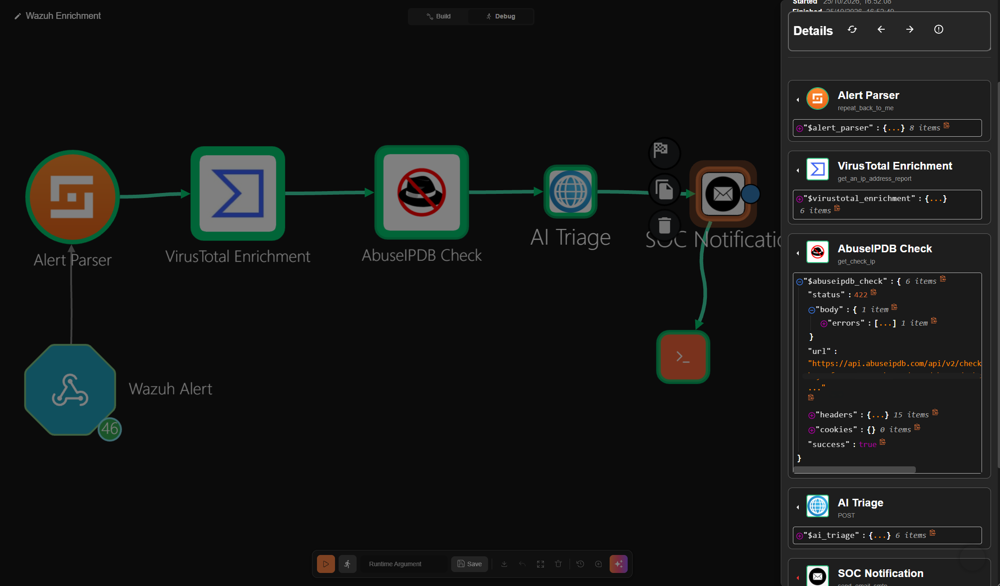
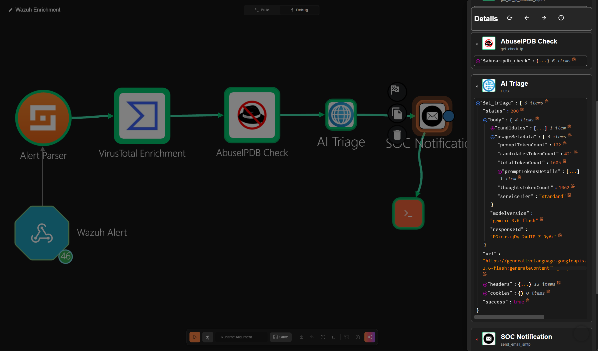
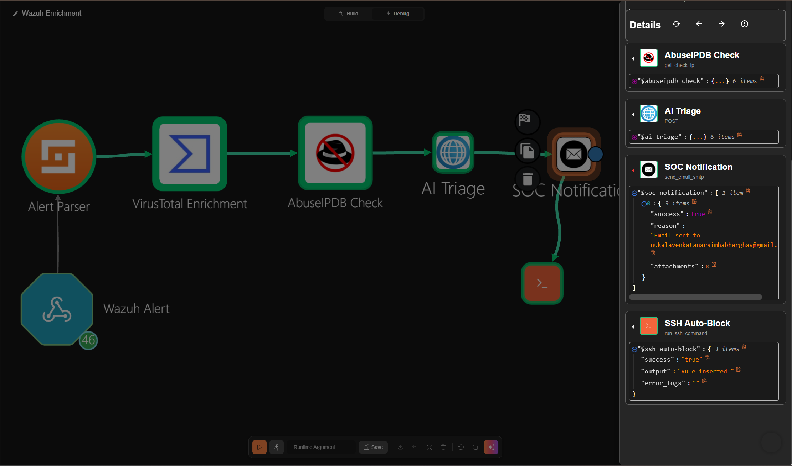

# Wazuh SIEM + Shuffle SOAR Detection & Response Pipeline

> **Cybersecurity Homelab · Project 1** | Built by Venkata Nukala

     

## Overview

Built a detection and **automated response** pipeline from scratch using Wazuh SIEM and Shuffle SOAR on a local VMware homelab. Simulated real attacker behaviour from a Kali Linux VM — network reconnaissance with Nmap (T1046) and SSH brute-force with Hydra (T1110) — and built a fully automated 7-node pipeline that detects, enriches with threat intel from two sources, generates AI-powered L1 triage via Google Gemini, notifies via email, and **automatically blocks** the attacker at the firewall — no human action required.

## Architecture

```
[Kali Linux 192.168.68.131]
        |
        |  Nmap scan (T1046) + Hydra SSH brute force (T1110)
        v
[Ubuntu Server 192.168.68.130]  <-- Target
        |
        |  /var/log/auth.log (Docker volume mount)
        v
[Wazuh SIEM - Docker]
        |
        |  Integration filter: rule_id 5712 (sshd brute force) only
        v
[Shuffle SOAR - Webhook]
        |
        |-- [1] Wazuh Alert        (Trigger — receives raw JSON from Wazuh)
        |-- [2] Alert Parser       (Extracts all_fields from webhook payload)
        |-- [3] VirusTotal         (IP reputation — malicious vendor count)
        |-- [4] AbuseIPDB Check    (Crowdsourced abuse confidence score 0–100%)
        |-- [5] AI Triage          (Google Gemini — L1 SOC analyst triage report)
        |-- [6] SOC Notification   (Email — full enriched alert to analyst inbox)
        |-- [7] SSH Auto-Block     (ufw deny from <attacker_ip> on target host)
        v
[Ubuntu Firewall - UFW]
        |
        |  Attacker IP blocked — all traffic dropped
        v
[Hydra: ERROR — all children disabled due to too many connection errors]
```

## Lab Environment

| VM | OS | IP | Role | Resources |
|---|---|---|---|---|
| Ubuntu Server | Ubuntu 22.04 LTS | 192.168.68.130 | Wazuh Manager + Shuffle SOAR | 4 vCPU · 8 GB RAM |
| Kali Linux | Kali 2024.x | 192.168.68.131 | Attacker VM | 4 vCPU · 4 GB RAM |
| Windows 10 | Windows 10 | 192.168.68.1 | Wazuh Agent (host) | Host machine |

All VMs run on VMware Workstation Pro on the host machine.

## Attack Simulations

### T1046 — Network Service Scanning (Nmap)
```bash
# Aggressive full-port SYN scan
nmap -sS -A 192.168.68.130
```
**Result:** All ports filtered by firewall — scan logged, below level 10 threshold, no email triggered. Confirms passive detection is working without alert fatigue.

### T1110 — Brute Force (Hydra)
```bash
# SSH brute force with 4 threads
hydra -I -l testuser -P /usr/share/wordlists/rockyou.txt 192.168.68.130 ssh -t 4
```
**Result:** Rule 5712 fired → Shuffle webhook triggered → full 7-node pipeline executed → VirusTotal + AbuseIPDB enriched attacker IP → Gemini generated L1 triage report → email delivered to analyst inbox → UFW blocked attacker IP → Hydra received "too many connection errors" and terminated.

---

## Screenshots

### Wazuh Alert — Rule 5712 Fired


Rule 5712 ("sshd: brute force trying to get access to the system") fired at level 10 after 8 failed logins from `192.168.68.131` for the non-existent user `invaliduser`. Wazuh mapped it to MITRE T1110 Brute Force / Credential Access automatically. This is the only rule that triggers the Shuffle webhook.

---

### Wazuh Agents Dashboard — Both VMs Active


Ubuntu target (`MrRobot`) and Kali attacker both visible and reporting to the Wazuh manager.

---

### Shuffle SOAR — Full Pipeline


Wazuh Alert (webhook) → Alert Parser → VirusTotal Enrichment → AbuseIPDB Check → AI Triage (Gemini) → SOC Notification (email) → SSH Auto-Block. All 7 nodes visible in Build view.

---

### Shuffle Debug — Execution Overview


Execution status: **FINISHED**. Source: webhook. Started 16:52:08, finished 16:52:49. The incoming webhook payload carries `rule_id: "5712"`, confirming only the brute-force rule reaches Shuffle.

---

### Shuffle Debug — Alert Parser


The Alert Parser node showing the parsed Wazuh alert: severity, title, rule ID 5712, timestamp, and `all_fields` (11 items). Every downstream node reads its data from here.

---

### Shuffle Debug — VirusTotal Enrichment


**VirusTotal v3:** `status: 200`, IP `192.168.68.131` queried as `ip_address`, `success: true`.

---

### Shuffle Debug — AbuseIPDB Check


**AbuseIPDB v2:** `status: 422`. This is expected in the lab: AbuseIPDB only scores public IPs, and the attacker `192.168.68.131` is a private RFC 1918 address. Against a real internet attacker this returns an abuse confidence score of 0–100%. API key redacted.

---

### Shuffle Debug — AI Triage (Gemini)


**Google Gemini:** `status: 200`, `modelVersion: gemini-3.6-flash`, 122 prompt tokens, 421 response tokens. The model returns an L1 SOC analyst triage report built from the alert fields. API key redacted.

---

### Shuffle Debug — Email + SSH Auto-Block


**SOC Notification:** `success: true`, email sent to the analyst inbox.  
**SSH Auto-Block:** `success: "true"`, `output: "Rule inserted"`. The UFW deny rule for the attacker is in place on the Ubuntu server.  
End-to-end confirmation that every node in the pipeline ran successfully.

---

### Email Alert — Inbox Proof


The actual email received in Gmail. It contains the rule description, attacker IP, target host, severity level 10, MITRE T1110, the VirusTotal result, and Gemini's full triage: executive summary, MITRE mapping (T1110.001 Password Guessing), true/false positive assessment, and containment steps. The email is plain text, so the model's markdown (`###`, `**`) shows as literal characters.

---

## Sample Alert

```json
{
  "rule": {
    "id": "5758",
    "description": "Maximum authentication attempts exceeded",
    "level": 8,
    "mitre": {
      "technique": ["Brute Force"],
      "tactic": ["Credential Access"],
      "id": ["T1110"]
    }
  },
  "agent": { "name": "MrRobot" },
  "data": {
    "srcip": "192.168.68.131",
    "dstuser": "mrrobot"
  }
}
```

---

## Reproduce This Lab

The full Shuffle workflow is exported as `Wazuh Enrichment.json` in this repo.

**To import into your own Shuffle instance:**
1. Open Shuffle → **Workflows** → **Import workflow**
2. Upload `Wazuh Enrichment.json`
3. Update the Email node with your SMTP credentials
4. Update the VirusTotal node with your VirusTotal v3 API key
5. Update the AbuseIPDB Check node — add your AbuseIPDB v2 API key in the node's **Setup** tab
6. Update the AI Triage node URL with your Google AI Studio API key: `https://generativelanguage.googleapis.com/v1beta/models/gemini-3.6-flash:generateContent?key=YOUR_KEY`
7. Copy the new webhook URL and paste it into the `<hook_url>` field of the **host** file `wazuh-docker/single-node/config/wazuh_cluster/wazuh_manager.conf`, and set `<rule_id>5712</rule_id>` in the same `<integration>` block (don't edit `/var/ossec/etc/ossec.conf` inside the container; it gets overwritten on restart)
8. Restart the Wazuh manager container

You'll have the full 7-node pipeline running in under 10 minutes.

**Note for SSH auto-block node:** The SSH node uses key-based authentication. You'll need to:
1. Generate an SSH key pair on your target host: `ssh-keygen -t rsa -b 4096 -f ~/.ssh/shuffle_key -N ""`
2. Add the public key to `~/.ssh/authorized_keys`
3. Upload the private key file to Shuffle → Admin → Files
4. Reference the file ID in the SSH node's "Private key file id" field
5. Add a sudoers rule so the SSH user can run UFW without a password: `username ALL=(ALL) NOPASSWD: /usr/sbin/ufw`

---

## Key Learnings — What Actually Broke

**1. Docker container isolation hides the host filesystem**  
Wazuh runs in a Docker container. Even though `wazuh_manager.conf` pointed to `/var/log/auth.log`, the container couldn't see the host file — Docker doesn't expose the host filesystem by default. Fix: added a read-only bind mount in `docker-compose.yml`:
```yaml
volumes:
  - /var/log/auth.log:/var/log/auth.log:ro
```

**2. XML parser crashes on split closing tags**  
When saving `wazuh_manager.conf` in nano, the `</integration>` closing tag got split across two lines. Wazuh's XML parser threw error 1101 (mismatched tag) and the manager wouldn't start. Fix: opened the file in nano, found the split line, and put it back on one line.

**3. Alert threshold flooding the inbox**  
The default Shuffle trigger level was 3 — meaning every syslog event fires an email. Ran one Hydra scan and got 200+ emails in minutes. Fix: raised the `<level>` in the `<integration>` block in `wazuh_manager.conf` to 10:
```xml
<integration>
  <name>shuffle</name>
  <hook_url>YOUR_WEBHOOK_URL</hook_url>
  <level>10</level>
  <alert_format>json</alert_format>
</integration>
```
Level 10 was later replaced with `<rule_id>5712</rule_id>`. See Engineering Challenges below for why.

**4. Agent/manager version mismatch**  
`apt` installed Wazuh agent 4.14.9 but the manager runs 4.9.0 — they refused to handshake across major versions. Fix: manually downgraded the agent to match the manager version exactly.

**5. SSH authentication in Shuffle**  
The pre-filled private key file ID in the Shuffle SSH node didn't correspond to a valid key. Fix: generated a new RSA 4096-bit key pair on Ubuntu, added the public key to `~/.ssh/authorized_keys`, uploaded the private key to Shuffle Files, and referenced the new file ID.

**6. Attacker IP variable path in Shuffle**  
The Wazuh webhook payload wraps all alert fields under `all_fields` in Shuffle's format. The attacker IP is at `$alert_parser.all_fields.data.srcip` — not `$alert_parser.data.srcip` directly. Expanded the Runtime Argument view in Shuffle's debug pane to trace the exact JSON path.

**7. Shuffle variable naming is lowercase with underscores**  
Shuffle derives variable names from node display names: spaces become underscores and the whole name is lowercased. Node "Alert Parser" → `$alert_parser`. Node "AI Triage" → `$ai_triage`. Third-party advice suggesting `$Alert_Parser` or `$exec.Alert_Parser` is wrong and will silently fail.

**8. Gemini native Shuffle app double-concatenates the URL**  
The native Gemini app in Shuffle appends its own `/v1beta/models/...` path to whatever URL is set in authentication — causing a doubled path and 404. Fix: replace the native Gemini app with the generic HTTP node and set the full Gemini API URL directly in the node config.

**9. Gemini model deprecation for new API keys**  
`gemini-1.5-flash` and the unversioned `gemini-2.5-flash` alias are unavailable to new Google AI Studio API keys. Fix: use `gemini-3.6-flash` (`gemini-3.5-flash` also routes to it). Query `https://generativelanguage.googleapis.com/v1beta/models?key=YOUR_KEY` to see available models for your account.

**10. Extracting the triage text from Gemini's response**  
The triage text lives at `candidates[0].content.parts[0].text`, next to a base64 `thoughtSignature` field. My first guess, `parts.1.text`, pointed at a part that doesn't exist, and Shuffle dumped the whole `candidates` array into the email. Re-testing showed the real issue is Shuffle's path syntax: `.0` is not an array index (see Engineering Challenges below). Fix: `$ai_triage.body.candidates.#.content.parts.#.text`.

**11. AbuseIPDB isolated test behavior with empty variables**  
When testing the AbuseIPDB node in isolation (Test Action), Shuffle variables like `$alert_parser.all_fields.data.srcip` resolve to empty — no live pipeline data exists yet. AbuseIPDB's API hangs indefinitely on a blank IP request (no error, just timeout). Fix: temporarily hardcode a real IP like `8.8.8.8` for API connectivity verification, then restore the variable path before wiring into the full pipeline.

**12. UFW block persistence across Hydra re-tests**  
A successful pipeline run inserts a `DENY` rule for the attacker IP into UFW. That rule persists across reboots and sessions. On the next Hydra re-test run, Hydra times out immediately because UFW still has the rule from the previous run — even though Shuffle never re-ran. Fix: run `sudo ufw delete deny from <attacker_IP> to any` on the target host before each new test cycle. Check current rules first with `sudo ufw status numbered`.

**13. UFW rule ordering matters**  
UFW evaluates rules top-to-bottom. A `ufw deny from <IP>` adds the rule at the bottom — below the existing `allow 22` rule — making it ineffective for SSH traffic. Fix: use `ufw insert 1 deny from <IP>` to place the deny rule at position 1, above all allow rules.

---

## Engineering Challenges & Root-Cause Troubleshooting

Problems from re-testing and hardening the finished pipeline, including after a full VM reboot.

| Symptom | Root cause | Fix |
|---|---|---|
| Some alert emails had a blank attacker IP, and one Hydra attack started 5+ pipeline runs | `<level>10</level>` let two rules through. Rule 5712 (sshd brute force) carries `data.srcip`. Rule 2502 (PAM "user missed the password more than one time") is also level 10 but has no source IP | Changed the integration filter to `<rule_id>5712</rule_id>`. One run per attack, and the IP is always present |
| The rule-5712 fix was gone after a VM reboot | I had edited `/var/ossec/etc/ossec.conf` inside the container. On every start, the container copies the host file `config/wazuh_cluster/wazuh_manager.conf` (bind-mounted to `/wazuh-config-mount/etc/ossec.conf`) over it | Found the mount with `docker inspect`, made the change in the host file, restarted the container. The fix now survives reboots |
| Gemini returned `429 RESOURCE_EXHAUSTED` | Free tier allows 20 requests per day per model for `gemini-3.6-flash`. Five runs per attack used it up fast | One run per attack after the rule fix. Quotas are counted per model |
| `gemini-2.0-flash` returned 404; `gemini-3.8-flash` hit `ReadTimeout`, then `503 UNAVAILABLE` | 2.0 is retired. 3.8 is a slow thinking model and was overloaded; raising the HTTP timeout to 60s did not help | Pinned `gemini-3.6-flash`. Checked the `url` field in the run output to confirm which model actually ran |
| After the reboot no workflow ran and Runtime Location showed "Stopped" | Orborus logs: `dial tcp 192.168.68.130:5001: i/o timeout`. The backend was listening on `0.0.0.0:5001` and answered from the host, but traffic from the Orborus container to the host IP was dropped. UFW allowed only port 22 | `sudo ufw allow 5001/tcp` and `sudo ufw allow 3001/tcp`, then restarted Orborus |
| Orborus connected but sat idle: "Orborus UUID mismatch… another Orborus (Leader) is already handling this Runtime Location queue" | The backend still held the pre-restart Orborus as leader | `docker restart shuffle-backend`. Orborus took over and started executing |
| ~10 alert emails arrived at once with no new attack | Alerts had queued in the backend while Orborus was down, and all ran on recovery | Expected behaviour. Each queued run is also one Gemini call, so it costs quota |
| AI triage section showed a JSON blob with `thoughtSignature` | In Shuffle, `.0` is not an array index. It is read as a key named `"0"`, the lookup fails, and Shuffle prints the parent array | `$ai_triage.body.candidates.#.content.parts.#.text`. `.#` is Shuffle's list operator. Trade-off: the text arrives wrapped in `["..."]` with literal `\n` |
| `grep "192.168.68.131" alerts.json` returned a "Successful sudo to ROOT executed" alert | Wazuh had logged my own `sudo grep` command, which contained the IP | Searched the decoded field instead: `grep '"srcip":"192.168.68.131"'` |

---

## What I'd Do Differently

- Install dedicated Wazuh agents on each VM instead of using Docker volume mounts — cleaner architecture and works out of the box at scale
- Set alert level thresholds **before** running the first attack, not after the inbox floods
- Run `docker compose logs -f` while configuring to catch XML parse errors immediately instead of after a failed restart
- Keep a running doc during the build — the interesting stuff happens in the failures, not the successes
- Set up SSH key-based auth for Shuffle from the start — the extra setup is worth it for automated response nodes
- Filter the webhook on specific rule IDs from day one instead of a severity level
- Parse the Gemini response with a Python transform node instead of Shuffle path syntax, so the email gets clean line breaks (planned for v2)

---

## Tech Stack

| Tool | Version | Purpose |
|---|---|---|
| Wazuh | 4.9.0 | SIEM — log ingestion, detection, alerting |
| Shuffle SOAR | Latest | Automation — webhook, enrichment, response |
| VirusTotal API | v3 | IP reputation — malicious vendor detections |
| AbuseIPDB API | v2 | Crowdsourced abuse confidence score |
| Google Gemini | gemini-3.5-flash (→3.6) | AI-powered L1 SOC triage analysis |
| OpenSearch | Bundled | Log storage and dashboard |
| Docker Compose | Latest | Container orchestration |
| Kali Linux | 2024.x | Attacker VM — Nmap, Hydra |
| Ubuntu Server | 22.04 LTS | Target VM |
| Nmap | Latest | Network recon (T1046) |
| Hydra | Latest | SSH brute force (T1110) |
| UFW | Built-in | Automated firewall blocking |
| VMware Workstation Pro | Latest | Hypervisor |
| MITRE ATT&CK | — | Threat framework reference |
