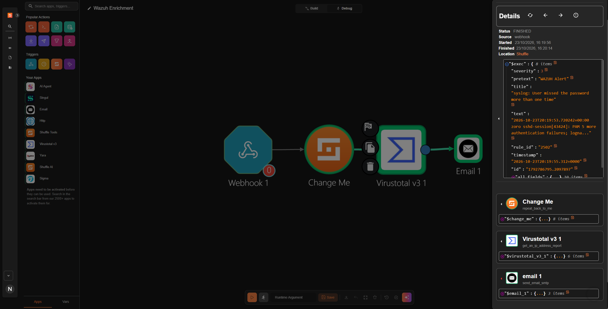
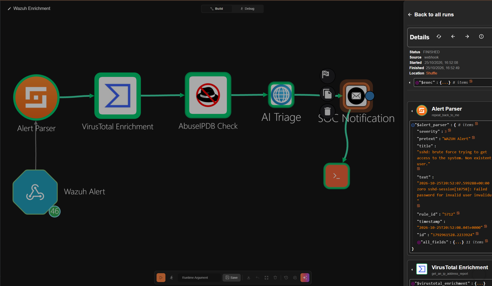
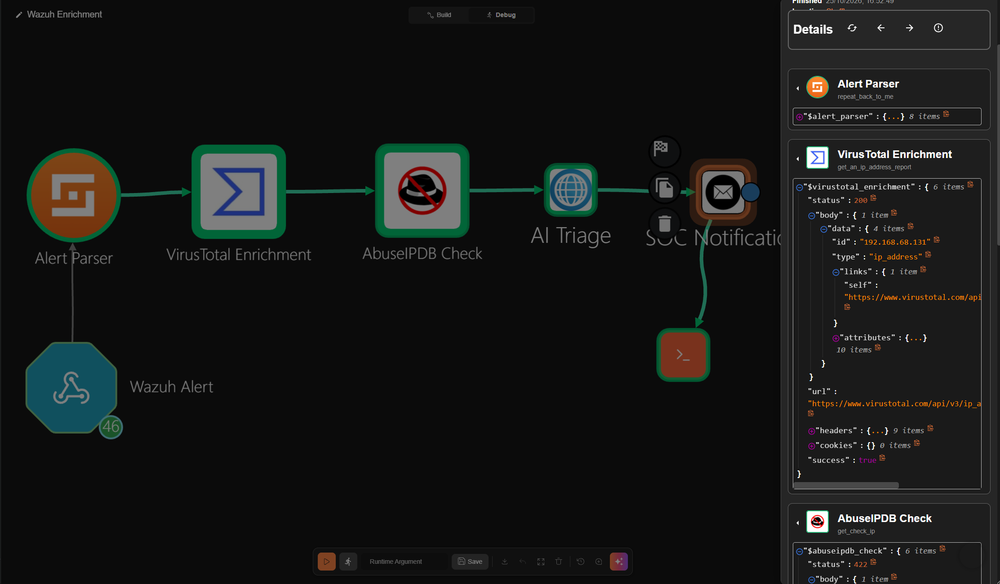

# Wazuh SIEM + Shuffle SOAR — Detection & Response Pipeline

A homelab cybersecurity project that builds a full detection-to-response pipeline: SSH brute-force attack from Kali Linux → Wazuh SIEM alert → Shuffle SOAR automation → email notification with VirusTotal IP enrichment.

---

## Architecture

```
Kali Linux (Attacker)
    │  SSH brute force (Hydra)
    ▼
Ubuntu Server 22.04 (Target)
    │  /var/log/auth.log (bind-mounted read-only into Wazuh container)
    ▼
Wazuh Manager 4.9.0 (Docker)
    │  Rule 5758 fires → level 8 alert → webhook trigger
    ▼
Shuffle SOAR
    │  Webhook → Change Me → VirusTotal IP lookup → Email
    ▼
Email Alert received
```

---

## Lab Environment

| Machine | Role | OS |
|---|---|---|
| Ubuntu 22.04 Server | Wazuh Manager + Shuffle SOAR (Docker) | Ubuntu 22.04 LTS |
| Kali Linux 2024.x | Attacker VM | Kali Rolling |
| Windows 10 | Wazuh Agent (endpoint monitoring) | Windows 10 |

All VMs run on VMware Workstation Pro on the host machine.

---

## Attack Simulation Results

### Nmap SYN Scan (T1046 — Network Service Discovery)
- Logged by Wazuh but stayed **below level 10 threshold** → no email triggered
- Confirms passive detection is working without alert fatigue

### Hydra SSH Brute Force (T1110 — Brute Force)
- **Rule 5758** fired: *"Maximum authentication attempts exceeded"*
- Alert level: **8** | MITRE: **T1110 — Credential Access / Brute Force**
- Shuffle webhook triggered → VirusTotal queried attacker IP → **email received within ~2 minutes**

---

## Screenshots

### Wazuh Alert — Rule 5758 Fired


Rule 5758 fired at level 8. Attacker IP `192.168.68.131` mapped to MITRE T1110 Brute Force / Credential Access automatically by Wazuh's built-in rule set.

---

### Wazuh Agents Dashboard — Both VMs Active


Ubuntu target (`MrRobot`) and Kali attacker both visible and reporting to the Wazuh manager.

---

### Shuffle SOAR — Workflow Build


Webhook → Change Me (alert parser) → VirusTotal v3 (IP enrichment) → Email. Full pipeline visible in Build view.

---

### Shuffle Debug — Execution Overview


Execution status: **FINISHED**. Source: webhook. Started 16:19:56, finished 16:20:14. Full Wazuh JSON payload visible flowing through the pipeline.

---

### Shuffle Debug — Wazuh Alert Payload


The Change Me node showing the parsed Wazuh alert: severity, title, rule ID 2502, timestamp, and all_fields (10 items). This is the raw JSON Wazuh sent to Shuffle.

---

### Shuffle Debug — VirusTotal + Email Result


**VirusTotal v3:** `status: 200`, IP `192.168.68.131` queried, `success: true`.  
**Email 1:** `success: true`, `reason: "Email sent to nukalavenkatanarsimahabharghav@gmail.com"`.  
End-to-end confirmation that every node in the pipeline ran successfully.

---

## Sample Alert (from Wazuh Dashboard)

```json
{
  "rule": {
    "id": "5758",
    "description": "Maximum authentication attempts exceeded",
    "level": 8,
    "mitre": {
      "technique": ["Brute Force"],
      "tactic": ["Credential Access"],
      "id": ["T1110"]
    }
  },
  "agent": { "name": "MrRobot" },
  "data": {
    "srcip": "192.168.68.131",
    "dstuser": "mrrobot"
  }
}
```

---

## Reproduce This Lab

The full Shuffle workflow is exported as `Wazuh Enrichment.json` in this repo.

**To import it into your own Shuffle instance:**
1. Open Shuffle → go to **Workflows**
2. Click **Import workflow**
3. Upload `Wazuh Enrichment.json`
4. Update the Email node with your own SMTP credentials
5. Update the VirusTotal node with your own API key
6. Copy the new webhook URL and paste it into your `wazuh_manager.conf` `<hook_url>` field
7. Restart your Wazuh manager container

You'll have the full Webhook → VirusTotal → Email pipeline running in under 5 minutes.

---

## Key Learnings — What Actually Broke

**1. Docker isolation hides the host filesystem**  
Wazuh runs in a Docker container. Even though `wazuh_manager.conf` pointed to `/var/log/auth.log`, the container couldn't see it. Fix: added a read-only bind mount in `docker-compose.yml`:
```yaml
- /var/log/auth.log:/var/log/auth.log:ro
```

**2. XML parser crashes on split closing tags**  
When saving `wazuh_manager.conf` in nano, the `</integration>` closing tag got split across two lines. Wazuh's XML parser threw error 1101 (mismatched tag) and the manager wouldn't start. Fix: found the split line in nano and put it back on one line.

**3. Alert threshold flooding the inbox**  
The default Shuffle trigger level was 3 — which means every syslog event fires an email. Ran one Hydra scan and got 200+ emails. Fix: raised the `<level>` in the `<integration>` block to 10.

**4. Agent/manager version mismatch**  
Wazuh agent 4.14.9 wouldn't connect to manager 4.9.0 — they refused to handshake across major versions. Fix: downgraded the agent to match the manager.

---

## What I'd Do Differently

- Install dedicated Wazuh agents on each VM instead of using Docker volume mounts — cleaner architecture and works out of the box
- Set alert thresholds **before** running the first attack, not after inbox flood
- Run `docker compose logs -f` while configuring to catch XML errors immediately
- Keep a running doc during the build — most of the interesting stuff happens in the failures, not the successes

---

## Tech Stack

| Tool | Version | Purpose |
|---|---|---|
| Wazuh | 4.9.0 | SIEM — log ingestion, detection, alerting |
| Shuffle SOAR | Latest | Automation — webhook, enrichment, email |
| OpenSearch | Bundled | Log storage and dashboard |
| Docker Compose | Latest | Container orchestration |
| Kali Linux | 2024.x | Attacker VM — Nmap, Hydra |
| Ubuntu Server | 22.04 LTS | Target VM |
| Nmap | Latest | Network recon (T1046) |
| Hydra | Latest | SSH brute force (T1110) |
| VMware Workstation Pro | Latest | Hypervisor |
| MITRE ATT&CK | — | Threat framework reference |
